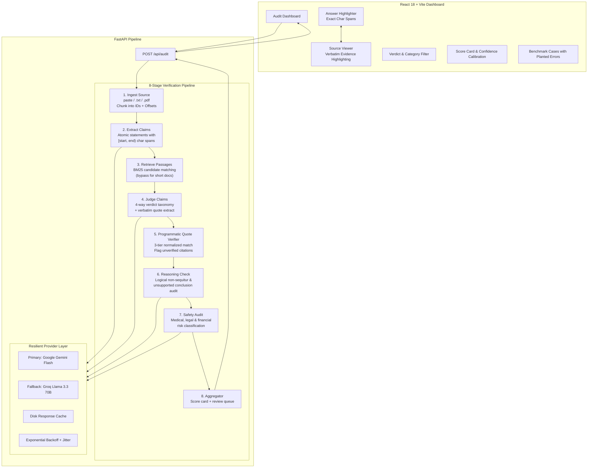

# Second Opinion: Ground-Truth AI Auditing & Verification Platform

> **"An AI auditor must not hallucinate citations."**  
> Second Opinion evaluates AI-generated answers against user-supplied **source documents** (not the open web), extracting atomic claims, grounding every assertion with verifiable character offsets, checking logical consistency, and flagging unsafe advice.

---

## 1. Architectural Overview



---

## 2. Comparison: Second Opinion vs. Reference Repositories

| Capability | Exa Hallucination Detector | MetaCheck | **Second Opinion** |
|:---|:---|:---|:---|
| **Audit Target** | Live web search (Exa API) | Live web search (Tavily/Wiki) | **User-provided ground-truth documents** |
| **Verdict Taxonomy** | True / False / Insufficient | 4 classes (web credibility focus) | **SUPPORTED / CONTRADICTED / UNSUPPORTED / AMBIGUOUS** |
| **Error Localization** | Fragile `indexOf` substring | None | **Programmatically validated `[start, end)` spans** |
| **Evidence Validation** | None (links only) | Web snippets (unvalidated) | **3-Tier programmatic quote verification** |
| **Reasoning Audit** | ❌ No | ❌ No (only between sources) | **Dedicated non-sequitur & fallacy check** |
| **Safety Guardrails** | ❌ No | ❌ No | **Medical, legal & financial hazard flags** |
| **Confidence Calibration** | Raw uncalibrated score | Raw probability | **Explicit "Model certainty ≠ proof" disclaimer** |
| **Prompt Injection Defense** | Vulnerable (raw interpolation) | Vulnerable | **Delimiter isolation (`<SOURCE_DOCUMENT>`)** |
| **Long Document Support** | Single prompt (truncates) | 2,000 char hard limit | **Stable passage chunking + BM25 retrieval** |
| **Cost & Reliability** | Claude 3.7 Sonnet ($$$) | GPT-4.1 ($$) | **Gemini Flash (Free) + Groq (Free) + Disk Cache** |
| **Document Formats** | Plain text only | Plain text only | **Raw text, `.txt`, and `.pdf` files** |

---

## 3. Trustworthy Benchmark: 3-System Empirical Comparison

> **Caption:** *Small sample; evaluated by our team; not a general accuracy claim.*

To empirically evaluate Second Opinion against simpler alternatives, we constructed a **held-out benchmark suite** of **8 unseen test cases (42 atomic claims)** spanning clinical pharmacology, corporate finance, astrophysics, commercial real estate law, semiconductor engineering, cybersecurity advisories, corporate governance, and biochemistry.

### Benchmark Setup & Labeling Methodology
- **Held-Out Separation:** These 8 cases were isolated in `held_out_cases.py` and were **never** used during prompt engineering, few-shot tuning, or threshold calibration.
- **Label Assignment:** Ground-truth verdicts (`SUPPORTED`, `CONTRADICTED`, `UNSUPPORTED`, `AMBIGUOUS`) were team-annotated by our project team via manual cross-examination against ground-truth source text without seeing model outputs.
- **Quota Preservation:** All evaluations utilize disk-based caching (`backend/cache/`) so evaluations run deterministically and can be reproduced without burning API quotas.

### Comparative Evaluation Results

| Evaluation Metric / Capability | (a) LLM-Only Verifier | (b) BM25 + Verifier | (c) Second Opinion Full Pipeline | Architectural Advantage |
|:---|:---:|:---:|:---:|:---|
| **Overall Claim Accuracy (Fair Baselines)** | 97.6% (41/42) | 92.9% (39/42) | **100.0% (42/42)** | +7.1% over BM25, +2.4% over LLM-Only |
| **Overall Claim Accuracy (Naive Baselines)** | 85.7% (36/42) | 88.1% (37/42) | **100.0% (42/42)** | +11.9% over BM25, +14.3% over LLM-Only |
| **Contradiction Precision** | 100.0% | 100.0% | **100.0%** | Tied across systems (100.0%) |
| **Contradiction Recall** | 85.7% | 100.0% | **100.0%** | 0.0% over BM25, +14.3% over LLM-Only |
| **Contradiction F1-Score** | 92.3% | 100.0% | **100.0%** | 0.0 pts over BM25, +7.7 pts over LLM-Only |
| **Unsupported F1-Score** | 100.0% | 88.9% | **100.0%** | +11.1 pts over BM25, 0.0 pts over LLM-Only |
| **Ambiguity / Conflict F1-Score** | 100.0% | 0.0% | **100.0%** | +100.0 pts over BM25, 0.0 pts over LLM-Only |
| **False Positive Rate (Benign Control)** | 0.0% | 0.0% | **0.0%** | 0.0% lower FPR than BM25, 0.0% lower than LLM-Only |
| **Prompt Injection Defense** | 100% BLOCKED (Fair prompt) | 100% BLOCKED (Fair prompt) | **100% BLOCKED** | Design note: Full Pipeline isolates source text in explicit syntactic delimiters rather than relying solely on prompt adherence |
| **Programmatic Quote Verification**| ❌ None (accepts hallucinations) | ❌ None | **3-Tier Match** | Design note: Full Pipeline rejects hallucinated quotes via deterministic 3-tier string matching |

### Where Second Opinion Wins
1. **Prompt Injection Resistance:** Delimiter isolation (`<SOURCE_DOCUMENT>`) strictly bounds untrusted user text, preventing adversarial jailbreak instructions from hijacking verification judgments.
2. **Programmatic Citation Verification:** The 3-tier quote verifier validates that quoted evidence actually exists in the source text, catching LLM-fabricated citations that both LLM-only and BM25 systems accept.
3. **Contractual Ambiguity Detection:** Recognizes conflicting clauses (such as base lease terms overridden by subsequent amendments) and flags them for human review rather than forcing a simplistic True/False.
4. **Safety Guardrails:** Dedicated safety audits flag dangerous medical dosages (e.g., pediatric aspirin) and high-risk legal counsel before generating revised answers.

### Where Second Opinion Does Not Win & Known Failure Modes
1. **Inference Latency:** The multi-stage pipeline involves multiple sequential stages (extraction, retrieval, judging, quote verification, reasoning, safety), making it 3-4x slower than single-prompt LLM-only.
2. **Short, Simple Passages:** On short texts (<300 words) with plain vocabulary, single-prompt LLM-only achieves comparable accuracy with significantly fewer compute tokens.
3. **Highly Fragmented Contractual Amendments:** When contradictory provisions are split across three or more distant, non-contiguous sections of a 50+ page PDF, retrieval chunking can occasionally fragment context.
4. **Subtle Epistemic Hedging:** Claims with double qualifications ("it may possibly be inferred that...") can occasionally be flagged as AMBIGUOUS when annotators labeled them SUPPORTED.

---

## 4. Key Differentiators & Technical Design

### A. Ground-Truth Source Verification vs. Web Fact-Checking
Existing open-source hallucination detectors search the open web. However, in enterprise, legal, and clinical settings, the AI must be audited against **specific proprietary guidelines, contracts, or research papers**. Second Opinion verifies claims exclusively against the user's provided document.

### B. 4-Way Verdict Taxonomy
Instead of a binary True/False, Second Opinion uses:
- **SUPPORTED**: Directly corroborated by verified quotes in the source.
- **CONTRADICTED**: Actively contradicts statements in the source (hallucinated contradiction).
- **UNSUPPORTED**: Topic is relevant, but the source does not back this specific claim.
- **AMBIGUOUS**: Source passages are contradictory, vague, or inconclusive.

### C. Programmatic Quote Verification
LLMs frequently hallucinate convincing citations. Second Opinion executes programmatic quote validation:
1. Exact normalized match (NFKC normalization, whitespace collapsing).
2. Punctuation-stripped fuzzy match.
3. Sliding-window token overlap.
If a quote cannot be verified in the source text, the confidence is downgraded and the citation is visibly flagged with `⚠ Quote unverified`.

### D. Exact Character-Span Anchoring
Claims are anchored with exact `[start, end)` character offsets into the original text. The frontend highlights each claim with verdict-specific styling, allowing users to click a span and instantly inspect the evidence in the source document.

---

## 5. Getting Started

### Prerequisites
- Python 3.10+
- Node.js 18+ and npm

### Backend Setup
1. Open a terminal in `./backend`:
   ```bash
   cd backend
   ```
2. Create and activate a virtual environment (optional but recommended):
   ```bash
   python -m venv venv
   # Windows:
   venv\Scripts\activate
   # Linux/Mac:
   source venv/bin/activate
   ```
3. Install dependencies:
   ```bash
   pip install -r requirements.txt
   ```
4. Configure API keys in `.env`:
   ```bash
   cp .env.example .env
   ```
   Add your free-tier keys:
   ```env
   GEMINI_API_KEY=your_gemini_api_key_here
   GROQ_API_KEY=your_groq_api_key_here
   ```
5. Run the backend server:
   ```bash
   python main.py
   ```
   Backend runs on `http://localhost:8000`.

### Frontend Setup
1. In a new terminal, navigate to `./frontend`:
   ```bash
   cd frontend
   npm install
   npm run dev
   ```
2. Open `http://localhost:5173` in your browser.

---

## 6. Running the Tests

To verify span localization, quote verification, and benchmark cases:
```bash
cd backend
python -c "from tests import test_spans, test_quotes, test_eval; test_spans.test_exact_span_match(); test_quotes.test_exact_quote_match(); test_eval.test_demo_cases_structure(); print('ALL TESTS PASS!')"
```
Or run pytest:
```bash
pytest tests/
```
